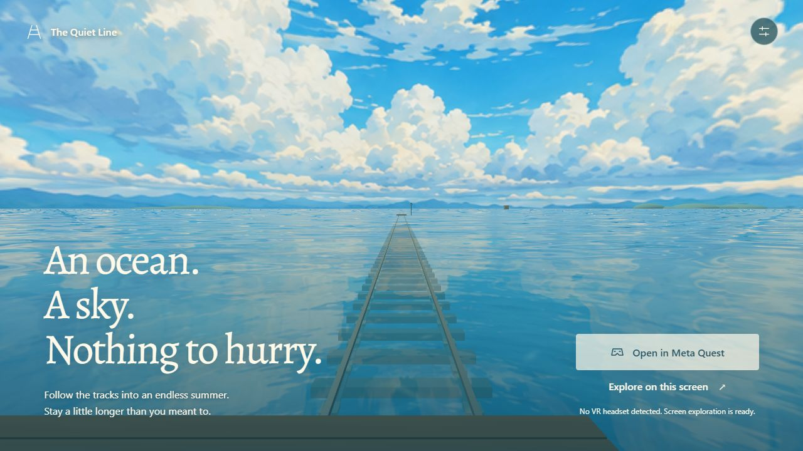

# The Quiet Line

A tiny station in an immense painted summer sea. A local, static WebXR experience for Meta Quest, with an interactive desktop and mobile preview.

**[Enter The Quiet Line](https://wildelmo.github.io/the-quiet-line/)** · [Build and deployment](https://github.com/wildelmo/the-quiet-line/actions/workflows/pages.yml)



## Run

Requires Node.js 20.19+ or 22.12+.

```sh
npm install
npm run dev
```

Open the printed local address. Select **Explore on this screen**. Drag to look; arrow keys also turn the camera. Space starts or stops the slow journey, V changes viewpoint, R returns to the station, M mutes, and H opens settings. Buttons and settings also work on touch screens.

```sh
npm test
npm run build
npm run preview
```

`dist/` is the complete deployable site. Relative asset URLs support the GitHub Pages project subdirectory. Public source repository: [wildelmo/the-quiet-line](https://github.com/wildelmo/the-quiet-line). There is no backend, analytics, or account requirement.

## Automatic deployment

The `pages.yml` GitHub Actions workflow runs all tests and builds the site on pushes and pull requests to `main`. Successful pushes to `main` deploy `dist/` to GitHub Pages over HTTPS. Pull requests only test and build; they cannot deploy. You can also run the workflow manually from the Actions tab. Official GitHub actions are pinned to release commits, and only the deploy job receives Pages write permission.

## Quest launch

Open **https://wildelmo.github.io/the-quiet-line/** directly in Meta Quest Browser and select **Step inside in VR**. Allow the browser's immersive session prompt. All runtime assets and sounds are local; after the site is loaded it makes no third-party asset requests.

For local headset development before hosting, use Meta's USB/ADB port forwarding (`adb reverse tcp:5173 tcp:5173`) and visit `http://localhost:5173` in the headset. This requires an already configured developer headset and USB debugging authorization. A plain LAN URL such as `http://192.168.x.x:5173` supports the flat preview but is not a secure context for immersive WebXR. A trusted HTTPS development host is another option. Do not bypass certificate warnings.

Official references: [Meta WebXR overview](https://developers.meta.com/vr/documentation/web/webxr-overview/), [WebXR secure contexts](https://developer.mozilla.org/en-US/docs/Web/API/WebXR_Device_API/Permissions_and_security), [Three.js WebXR manager](https://threejs.org/docs/pages/WebXRManager).

## In the headset

- Start stationary at the little station, at real-world head height. Room-scale head tracking is preserved. No automatic bobbing, roll, or camera orbit.
- Point either controller at the brass ticket panel and pull the trigger to drift, pause, change viewpoint, mute, or return. The ticket travels with you. Squeeze either grip to recall it into your current view.
- **Exit experience** at the bottom of the VR ticket ends the immersive session, stops rendering, closes the audio context, and attempts to close the browser tab. The same control is available at the top of the flat-screen page, while loading, and if graphics fail. If the browser disallows closing a user-opened tab, the app replaces itself with `about:blank`, fully unloading the experience; only an empty browser tab remains. A stalled or rejected XR shutdown cannot block leaving. Browser restrictions are described in [MDN's window.close documentation](https://developer.mozilla.org/en-US/docs/Web/API/Window/close).
- Right thumbstick left/right: 30-degree snap turn, once per stick deflection.
- Hold the left thumbstick forward, point down at nearby water, and release to teleport to the ring. Teleports are limited to 35 meters and the railway corridor, with a brief blackout. A little observation deck appears beneath you.
- **Begin drifting** carries the entire station with you: platform, shelter, bench, plants, signs, and wind bell. These stay beside you while the tracks and sea pass underneath. Room-scale walking and snap turns remain independent of the platform. Starting drift from a remote observation deck brings the station to your current location; Return restores it to its original home. Travel eases up to 1.35 m/s and stops immediately when paused. It ends at 1.1 km rather than wrapping or snapping the world.
- Sound is generated on-device: layered water and wind, sparse bell tones, distant bird calls, and subtle travel pulses. The controls provide mute and volume. Audio begins only with user interaction.

## What is built

The reference is `Dreamy Ocean Sky Storyboard.png`. A generated painted panorama surrounds real 3D tracks, sleeper timbers, platform, shelter, bench, wind bell, distant house, islands, birds, and the travel deck. The water shader reflects the same sky and adds low-amplitude ripples, glints, and shallow-water caustics. Clouds are a distant painted sky, not nearby volumetric geometry. The application is designed for open space and a stable horizon.

Geometry is instanced or merged by material. There are no shadow maps, bloom passes, reflection render targets, live texture downloads, or continuous audio downloads. Balanced settings cap desktop pixel ratio at 1.5; XR uses a framebuffer scale of 1 and requested foveation of 1. `window.quietLine.diagnostics` is available in browser developer tools for draw calls, triangles, texture count, position and session state.

## Verification and remaining headset checks

Movement tests and the production build pass. A synthetic WebXR session exercises Three.js's actual stereo camera update, checking that both eyes travel with the deck even when the tracked viewer is several meters from the play-space origin. Additional checks cover boarding after rotation, physical walking, snap turns, pausing, and repositioning. Browser checks cover shader rendering, entering the flat experience, start/pause, viewpoints, mute, quiet water, settings, desktop and 390-pixel mobile layouts. No actual Quest headset was connected during development. Stereo rendering, controller mapping, perceived scale, audio balance, comfort, and sustained headset frame rate require a hardware check.

On the first Quest run: remain still, look all the way around and up, recall and use the ticket, test each controller, try a short teleport, then start and pause travel. Measure frame time using browser/Quest developer tools; the target is stable native headset refresh, not an unmeasured claim of performance. Use balanced detail first.

Asset provenance and the exact image prompt are in `ASSETS.md`.
