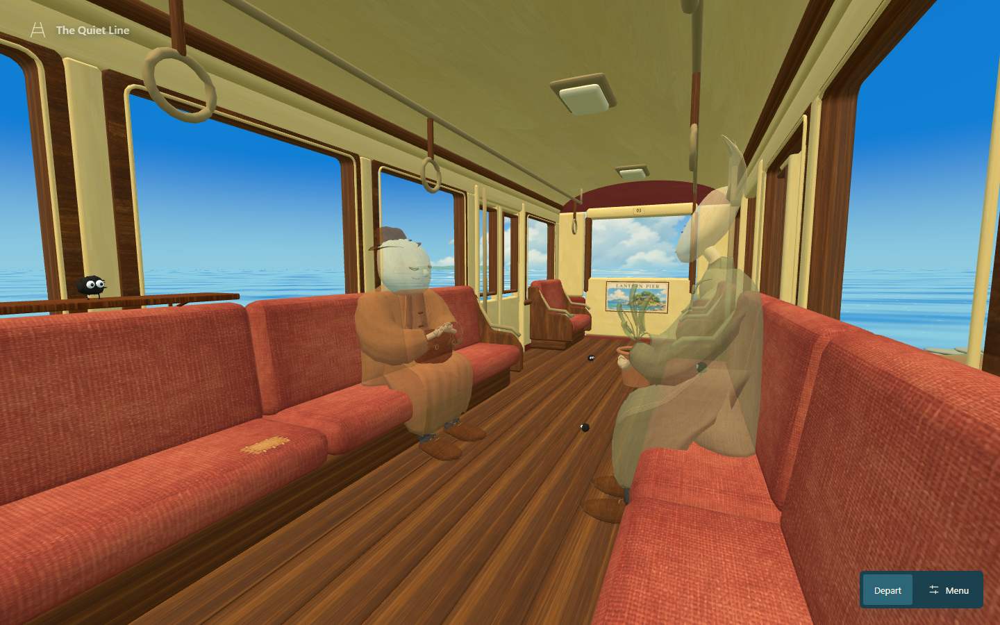
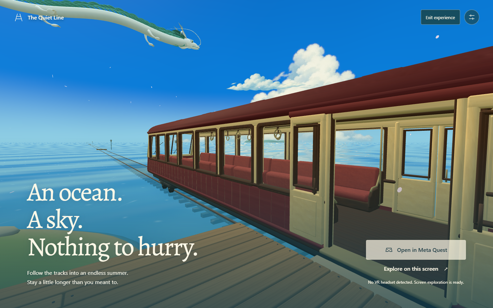
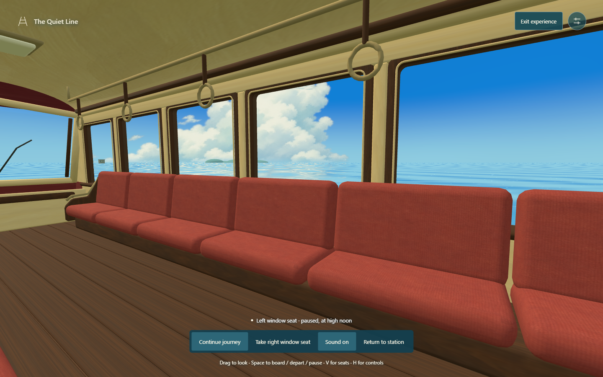
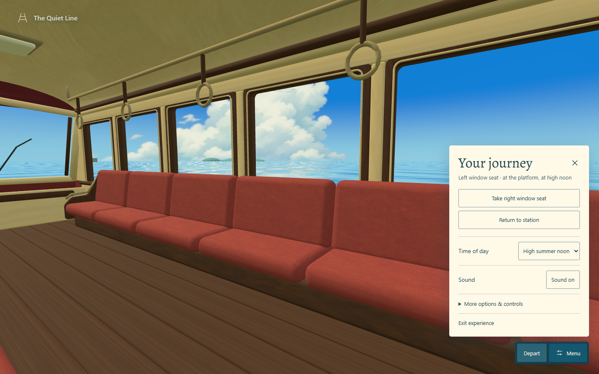
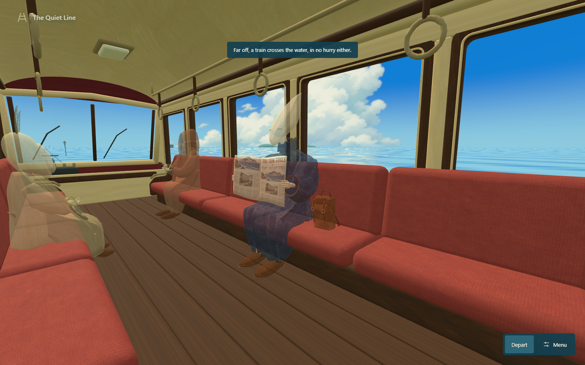
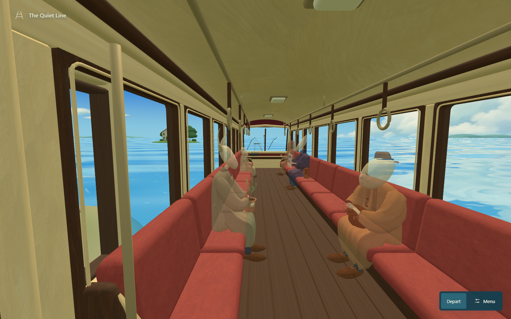
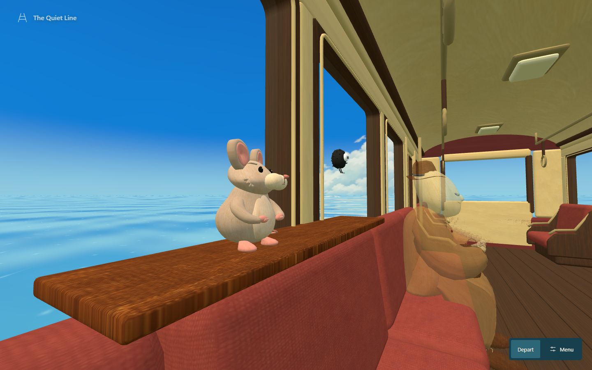
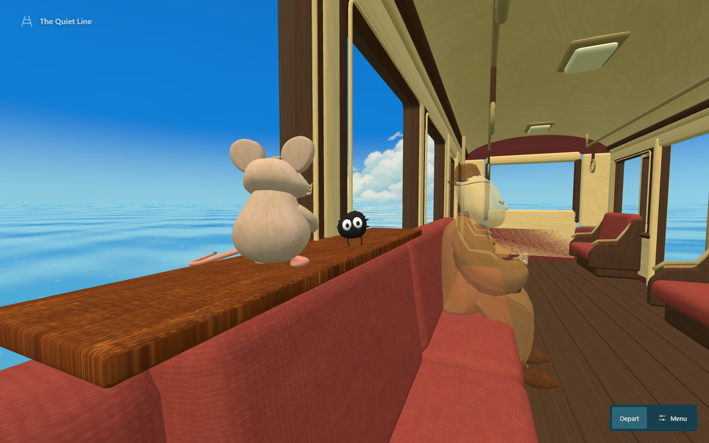
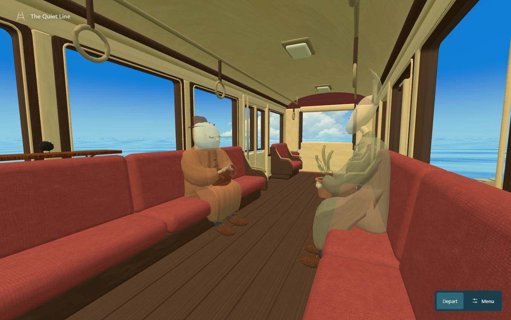
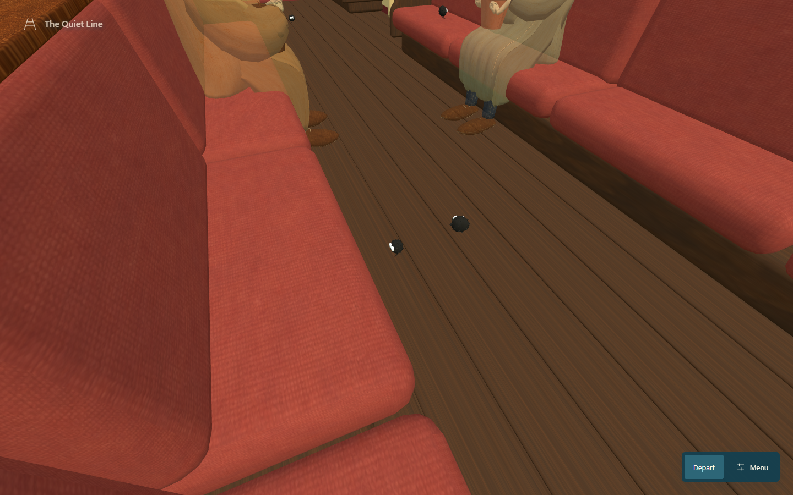

# The Quiet Line

A tiny station on a grassy shore in an immense painted summer sea. Board a waiting carriage, choose a window seat and travel across the water as one slow day passes: afternoon, golden sunset, blue dusk, lanterns and stars, then morning again. A static WebXR experience for Meta Quest, with an interactive desktop and mobile preview.

**[Published site](https://wildelmo.github.io/the-quiet-line/)** · [Build and deployment](https://github.com/wildelmo/the-quiet-line/actions/workflows/pages.yml)

The carriage has a worn, cared-for character: faded red cushions with two stitched repairs, rubbed timber and cream enamel, illustrated railway notices, carriage number 03, a folded scarf and a tied cloth parcel. Painted wear and soft static vertex shading are authored into the asset. The independent finish review returned **ship**, and the user accepted the finished result: “I think we nailed it.” This work is maintained on `codex/newspaper-spirit`; the published site remains the controls/audio release at `07d5af8`, successfully deployed by Actions run `42170566231`.

The preceding floor extension added six quick, curious fuzzballs: nine fuzzballs and one mouse now share the carriage. They scurry, poke around, listen and inspect independently, with grounded little strides and room around the passengers' feet. The user accepted that live colony: “Yeah I'm looking at it. I think it looks great.”

The preceding rear-wall repair removes the viewpoint-dependent maroon tearing reported in the user's screenshot. The maroon body and cream door had exactly coplanar interior faces; the rebuilt carriage surrounds the door with two side panels and a sill. The painted materials, five adult spirits at 70% opacity (30% translucency), opaque companions, quiet encounters, controls and camera behavior remain intact.

The preceding quiet-encounter extension lets a steady look invite one fuzzball closer for a brief shared gaze, followed by a shy retreat, a peek back and a return to its own game. The mouse mostly watches the sea, occasionally turning to its friend or the traveller. They remain silent, with long rests.





















## Run

Requires Node.js 20.19+ or 22.12+.

```sh
npm install
npm run dev
```

Open the printed local address, currently `http://127.0.0.1:5173`, and select **Explore on this screen**. Drag to look; arrow keys also turn the camera. The controls work by mouse, keyboard or touch:

| Action | Control |
| --- | --- |
| Board, then depart; pause or continue while aboard | Journey button or Space |
| Choose the left window seat, then alternate sides | Menu → Choose window seat, or V |
| Climb up and stand on the carriage roof | Menu → Stand on the roof, or U |
| Return to the station and restore the train to its berth | Menu → Return to station, or R |
| Let the day pass, or choose a named time | Menu → Time of day; T cycles times |
| Mute sound | Menu → Sound, or M |
| Open or close the menu | Menu button, H or Escape |

Only the journey button and **Menu** remain visible at the lower right during screen exploration. The menu opens above them with seats, return, named time choices and sound; **More options & controls** reveals volume, detail, quiet water, help and the welcome-screen action. **Exit experience** is in the menu. The Close button, H, Escape or a click on the world dismisses it; keyboard closing returns focus to Menu. Opening the menu and changing time or sound preserve the journey and view. Travel actions close it. Notices disappear after 3.2 seconds.

Boarding, changing seats and returning use a brief fade. Choosing a seat pauses travel; **Continue journey** resumes it. The train eases toward 3 m/s, slows near the end of its 1.1 km route, and stops at **Journey complete**. Pause stops it immediately. The station and landscape stay fixed. Returning restores the original berth and platform viewpoint. There is no free-water teleport or observation deck.

```sh
npm test
npm run build
npm run preview
```

`dist/` is the complete deployable site. Relative asset URLs support the GitHub Pages project subdirectory. Public source repository: [wildelmo/the-quiet-line](https://github.com/wildelmo/the-quiet-line). There is no backend, analytics or account requirement.

## Automatic deployment

The `pages.yml` GitHub Actions workflow runs tests and builds on pushes and pull requests to `main`. Successful pushes to `main` deploy `dist/` to GitHub Pages over HTTPS. Pull requests only test and build. The workflow can also run manually from Actions. Official GitHub actions are pinned to release commits, and only the deploy job receives Pages write permission.

## Quest launch and controls

For a deployed version, open **https://wildelmo.github.io/the-quiet-line/** in Meta Quest Browser and select **Step inside in VR**. Allow the browser's immersive session prompt. All runtime assets and sounds are local; the loaded experience makes no third-party asset requests.

For local headset development, use Meta's USB/ADB port forwarding (`adb reverse tcp:5173 tcp:5173`) and visit `http://localhost:5173` in the headset. This requires a configured developer headset and USB debugging authorization. A plain LAN URL supports the flat preview but is not a secure context for immersive WebXR; a trusted HTTPS development host is another option.

Official references: [Meta WebXR overview](https://developers.meta.com/vr/documentation/web/webxr-overview/), [WebXR secure contexts](https://developer.mozilla.org/en-US/docs/Web/API/WebXR_Device_API/Permissions_and_security), [Three.js WebXR manager](https://threejs.org/docs/pages/WebXRManager).

- Start at the fixed raised station. Boarding and seat placement preserve real tracked head height; look, lean and move naturally within your physical space. The ride adds no camera bobbing, roll or automatic orbit.
- The compact VR menu starts closed. Squeeze either grip to open or close it, then point and pull the trigger to choose. It offers the same ride actions as the screen controls, sound, return and exit. **Time of day** opens six named choices with **Back to journey**; **Close** dismisses either page.
- The menu appears only when requested, 0.9m ahead and 0.22m below your actual head, without a floor-height clamp. It does not reopen after boarding or seat changes. Travel actions, snap turns and XR visibility loss close it. Opening it or choosing time/sound preserves journey progress and gaze.
- Right thumbstick left/right turns by 30 degrees, once per deflection.
- Height is the headset's tracked height above the ground you are standing on: the platform, the carriage floor, the shore or the sea. If the headset reports a head height no person could have (below 0.35m or above 2.3m, which happens when a session begins before the room's floor is established), the ground is re-levelled so the eyes sit at standing height, and the correction eases away once a believable height returns. A headset view reset keeps you where you were standing, on the ground, facing the same way. `window.quietLine.diagnostics.rig` reports the tracked height and any correction.
- Push the left thumbstick forward to aim a ray from that controller at the ground: a cream ring marks where you will stand. Let the stick go to step there, with a brief fade. The platform, shore, carriage floor and the sea within 60m of the station are all open while the train is at home; stepping into the carriage counts as boarding and stepping out returns you to the platform, with the doors untouched. Once the train has left, only the carriage floor accepts a step. Departure, pause, seats and return stay on the menu.
- **Exit experience** in the VR menu ends the immersive session, stops rendering, closes the audio context and attempts to close the tab. Screen exploration keeps Exit in its menu; the welcome header, loading screen and graphics-error screen also have an exit. If the browser refuses to close a user-opened tab, the app navigates to `about:blank`; a stalled or rejected XR shutdown cannot block leaving. See [MDN's window.close documentation](https://developer.mozilla.org/en-US/docs/Web/API/Window/close).

The desktop preview uses authored standing and seated eye heights. A real XR session retains the visitor's tracked height instead. Headset input, perceived scale and comfort still require physical-device validation.

## What is built

The visual authority is `Dreamy Ocean Sky Storyboard.png`, refined by the user's direction for fewer clouds and dominant bright, deep blue. Four sparse painted banks sit in a procedural blue sky. Two locally shipped 1536 × 1024 transparent paintings supply their feathered ivory brushwork and pale-blue/mint washes. The older panoramas and nine procedural cloud sprites are retired. Water samples the same sky and adds low-amplitude ripples, glints and shallow-water caustics. Each ripple term, the shallow noise, the caustic streaks and the sun glitter fade out as their wavelength approaches the pixel footprint (`fwidth` of the water position), so distant water settles into a flat reflection instead of the shimmering moire that per-pixel sampling of fixed-frequency waves produced toward the horizon in a headset. Real submerged rails, the fixed station and shoreline, islands and the carriage give the world scale.

### One rideable carriage

The original Blender model has a cream-and-maroon exterior, rounded roof, real window openings, dark substantial frames, red bench upholstery, hanging straps, floorboards, sliding boarding doors and warm interior lamps. `assets/train/carriage.blend` is the editable source; `scripts/build-train.py` rebuilds it and `public/assets/train/carriage.glb`. `src/train.js` loads the GLB; `src/travel.js` owns the ride states and placements. See [the train asset guide](assets/train/README.md) for the rebuild command, coordinates and provenance.

The current GLB is 5,406,204 bytes, with 45,097 triangles, seven mesh primitives and five materials. Its one embedded 1536 × 1024 painted atlas costs about 8.00 MiB decoded as RGBA8 with mipmaps. Relative to the repaired rear-wall export (42,812 triangles; 3,951,092 bytes), this adds 2,285 triangles, 1,455,112 download bytes and an estimated 1,856 texture-memory bytes. All 13 matched browser views retain their draw-call counts. These are asset counts and desktop samples, not headset frame-time measurements; transparent double-sided glass can add a pass.

The upper right route notice reads **THE QUIET LINE**, with **REED BANK**, **SEA GLASS** and **LANTERN PIER**; the rear wall carries the seaside poster and **03** plate. Only two upward cushion faces receive repairs. The scarf and parcel are opaque static geometry joined into the existing material batch. The treatment adds no runtime JavaScript, lights, shadow passes or motion. The original atlas remains historical source; [lived-in material metadata](assets/train/lived-in-materials.json) records the current atlas, safe UVs and exact generation provenance.

### Little painted companions

A plump taupe mouse with cupped rose ears, pink paws and a curled tail sits on a shallow wooden perch above the right bench back. Its charcoal friend has bent tufts, skinny legs and prominent white eyes; two more fuzzballs occupy separate empty stretches of the left bench. Their ambient three-hop routes rise 2.25, 2.65 and 2.9 times each creature’s measured body height. Two short bursts in independent 43-, 47- and 53-second cycles leave more than three quarters of each cycle resting. Fuzzballs sometimes turn toward the view; the mouse mostly watches the sea, with small posture shifts, head scans, breathing, blinks and occasional turns to its friend.

While aboard, looking steadily toward a resting creature can invite its attention. One fuzzball at a time notices, takes two tentative hops closer, shares a short look, makes two quicker retreat hops, peeks back and hops home. It then resumes the same grounded point in its ambient routine. A shared 24-second rest after each encounter also separates the mouse's brief glances. Attention uses camera/head direction, not eye tracking. New encounters wait until the visitor has settled and stay disabled during menus, seat transitions, station visits and reduced motion. An encounter already underway finishes safely if attention is lost. No gaze marker or new instruction overlay is added.

Six additional fuzzballs explore the floor with independent seeded choices, uneven pauses and bounded acceleration, braking and turns. Their alternating hip strides follow distance travelled; the lowest posed foot vertex stays on the boards. Routes avoid conservative footprints around the actual exported shoes and reserve space around the traveller. Changing seats never snaps a creature away. These floor lives do not join the existing three hoppers' and mouse's attention encounters.

The mouse is about 23.13cm tall; the base fuzz sculpture is about 9.144cm tall, with scales of 1, 0.94 and 1.06 for the three hoppers and 0.82–1.15 for the floor colony. All ten creatures and their perch are opaque. They inherit carriage travel and stay still under reduced motion, adding no sounds, controls or camera movement. The visitor seats and boarding access remain usable.

`scripts/build-companions.py` produces the editable `assets/spirits/companions.blend`, exact metadata and `public/assets/spirits/companions.glb`. Separate hip pivots preserve the original rest geometry while allowing the existing legs to swing. The export has 17,266 triangles, ten primitives, two opaque materials and one embedded copy of the unchanged reader atlas, in 3,820,316 bytes. Six floor creatures share four instanced draw calls for body, eyes and legs. The full mouse/nine-fuzzball/perch addition totals 57,458 triangles and 22 draw primitives before culling. An opaque material clone shares the reader’s texture without changing adult translucency; the fuzz eyes use an untextured matte material with white eyeball and dark pupil vertex colors. Ambient fill respects those pigments at night. These counts are construction figures, not measured headset performance. See [the companion source guide](assets/spirits/COMPANIONS.md) for rebuilding, placement, motion and provenance.

### Five quiet fellow travellers

The approved newspaper reader remains on the right bench, with its pale seedpod face, worn indigo coat, small ivory hands and travelling bag. It reads **The Tide Times**, turns a page twice in a 119-second cycle, briefly looks toward the sea and settles its paper. The user caught a reversed turn after the original review: the corrected leaf now flexes toward the reader in its local negative-Z direction, staying clear of the coat.

Four original Blender sculptures share the carriage: a broad sleeper in an ochre coat and hat with a satchel, a small ivory moth with feathery antennae, a long-eared gardener in a sage smock holding a seedling, and a hooded rust-robed keeper with a sea shell. Independent 137-, 131-, 151- and 163-second cycles separate their small gestures with long rests. Both visitor seats, the boarding doorway and aisle remain clear. All five travel with the carriage, hold still under reduced motion and add no controls, dialogue or sounds.

`scripts/build-reader.py` and `scripts/build-passengers.py` rebuild the editable Blender sources, runtime GLBs and exact metadata. The corrected reader export has 32,672 triangles, seven primitives and a size of 4,207,944 bytes. The four-passenger export adds 51,996 triangles, 16 primitives and 4,746,744 bytes. Both embed the unchanged 1254 × 1254 painted reader atlas; the new cast uses vertex pigment washes without a new raster. At runtime they share the reader's actual material and texture, avoiding a duplicate GPU atlas allocation, though both GLB downloads still contain the image.

`src/spirit-material.js` gives figures and belongings uniform 70% opacity using a depth-only silhouette pass before the visible color pass. It blends the nearest surface once, avoiding opaque overlaps between limbs and cloth; this is surface translucency, not volumetric refraction. The 23 authored meshes can require 46 render submissions during a page turn, or 44 at rest, before culling. The extra pass shares geometry, and the atlas uses about 8 MiB decoded as RGBA8 with mipmaps. These construction figures do not establish headset performance. See [the spirit asset guide](assets/spirits/README.md) for rebuild, coordinates, animation and provenance.

The previews above are actual browser captures. [The generated reader concept study](output/reader-concept.png) guided the original character's silhouette and materials; it is separate from runtime evidence. The four new sculptures use that established material language without new image generation.

### The roof

Once aboard, **Stand on the roof** places the visitor on the crown of the barrel roof at full standing height, 3.7m above the rails, where it is nearly flat. The roof travels with the train like the seats; a window seat brings you back inside. A stick teleport can also land on the roof crown, and from the roof a step down onto the carriage floor goes back inside. On the roof the world sounds like outdoors again, with the wind rising with speed, and the petals and paper planes keep you company.

### Paper planes and the pod

Six folded paper planes glide about the visitor outdoors, on the same breeze as the petals: long shallow swoops, lazy banks, the occasional stall and dip. They are one instanced mesh and stay hidden inside the carriage.

A pod of three dolphins keeps the train company on the open-sea side while it is moving, arriving about half a minute after departure and then every few minutes: they swim alongside under the surface, leap clear in turn with a soft splash ring and a quiet water burst, and peel away after most of a minute. At the station a pod passes far out now and then. Bodies are procedural, two pigments merged per dolphin; reduced motion hides them.

### The passing day and small lives

`src/daylight.js` keeps one clock-hour for sky, water, fog, lighting, lanterns, stars, sun and moon. The world starts at the visitor's local time. Daylight hours last about a minute each and night hours pass faster; the menu, T key and VR time choices can hold any moment still. Reduced motion holds the daylight clock and cloud drift.

At the station, a ginger cat sleeps on the bench and briefly notices the far train whistle. A sea-glass passenger in a folded leaf cap arrives beside the suitcase, watches the dragon and leaves quietly. Lanterns, a pinwheel, streamers and butterflies bring the platform to life. Petals follow the visitor outdoors and are hidden inside the carriage. Fireflies and soft sea-lights appear after dark.

A distant four-car train and little floatplane pass periodically. Far rain and a slow cloud shadow share a breeze with the station and cottage island. A pearl-and-jade procedural dragon skims a painted veil, climbs through a vertical loop and banks into a dive. The user criticized the dragon's smooth procedural appearance; this carriage milestone does not replace it, and an earlier visual-review verdict does not establish user acceptance.

A fixed grassy island beside the route carries a cream cottage, terracotta roof, trees, bench and laundry. The moving carriage passes it while the station stays at home. Its windows warm at dusk. Audio is synthesized on-device: water, wind, bells, sparse music-box notes, birds, crickets, an evening pad, the far train whistle and plane hum remain. The default volume is now 35%. Low filtered rolling noise and soft, rounded paired track contacts replace the former repeated travel chimes. Contact groups follow distance about every 6m, so they slow with the train; soft attack/release avoids abrupt starts and settles the train layer to silence when paused. Sound begins only after interaction; mute and volume remain available.

The first audio pass sounded like a constant whoosh to the user. The revision reduces the continuous rolling bed, gives each paired contact a short, rounded low-mid tap, and softens water and wind inside the carriage. Following feedback about a low screech, the latest tuning removes sustained and sliding train tones and raises the bumps about 3dB. The default volume remains 35%.

[Listen to the revised 12-second soft knocks](output/train-track-soft-knocks.wav), or the [36-second journey sample](output/quiet-train-preview.wav) with acceleration, slowing, pause and resume. Both use the actual default gain without normalization and contain the train layer only. The latest tuning is retained for this release; actual Quest listening remains unverified.

Reduced motion also suppresses weather events, holds the station passenger, all five carriage spirits and the little companions at rest, freezes the dragon's local pose and the island's moving details, and makes door placement immediate. Some existing birds, bell, distant train and plane animation continues; it is not a total world-motion pause. Hidden flat-screen pages pause rendering and world updates. Document and XR visibility loss pause the journey.

Geometry is instanced or merged where appropriate. There are no shadow maps, bloom passes or reflection render targets. Balanced desktop settings cap pixel ratio at 1.5; XR uses framebuffer scale 1 and requested foveation 1. `window.quietLine.diagnostics` exposes sampled render counts, position, train state, route distance, station anchor, session and atmosphere state. These samples are not sustained performance measurements.

## Verification and remaining checks

All 95 automated tests and the production build pass in `.impeccable/review/character-tests.log` and `character-build.log`; the existing 732.63 kB JavaScript chunk advisory remains. `character-after-result.json` reports no browser errors across 19 final captures, including both seats, boarding, notices and belongings, day/night, 390px mobile and the user's 1354px viewport. Departure, pause and station return passed. All 13 matched views have unchanged draw calls and 2,285 additional triangles. The independent `character-finish-review.md` returned **ship**, with all 19 captures valid and no material fixes. `character-verification.md` records costs and limits; the detector is empty, and the provenance scan covers seven rasters with zero missing records. The user accepted the resulting carriage view; physical Quest validation remains outstanding. The review directory is local and ignored by Git.

At the preceding floor milestone, all 94 automated tests and the production build passed in `floor-tests.log` and `floor-build.log`. Floor checks cover three seeded three-minute simulations, frame-rate consistency, bounded time gaps and turns, actual exported shoe clearance, posed foot contact, instancing and carriage movement. `floor-result.json` passed without reported errors across 11 final captures covering boarding, both seats, scurrying, night, travel, mobile and reduced motion. Five captures were reframed after empty initial views; the recorded fixed-camera sequence follows Pip listening, scurrying, then listening. `floor-finish-review.md` returned **ship** after reviewing all eleven final images, source and supplied validation evidence, with no material fixes. The user's live acceptance is separate from physical Quest stereo, comfort and sustained performance or subjective continuous-video validation. `floor-detector.json` was empty; the then-current six-raster scan had no missing provenance.

At the preceding rear-wall milestone, all 90 automated tests and the production build passed in `rear-wall-tests.log` and `rear-wall-build.log`. A regression checks 28 opaque ray probes on the actual exported rear wall for closure and a single front surface. It fails on the old GLB with two identical nearest depths and passes on the rebuilt asset. `rear-wall-after-result.json` passed without reported errors across 19 captures: user-size and desktop angles from both seats, near-rear boarding, eye-contact/rest framing, night, mobile, travel, two separate exterior asset inspections and five frames from a slow yaw/pitch sweep. The sweep's WebM is retained, but continuous playback has not been visually certified. The user's screenshot and `rear-wall-finish-review.md` **fix** verdict supersede earlier approval for this defect. The original reviewer then returned **ship** in `rear-wall-verdict.md`, independently opening all 19 captures and resolving both findings with no visible repair-induced material regression. That verdict covers these two fixes only, with no whole-world or physical Quest claim.

At the preceding quiet-encounter milestone, all 89 automated tests and the production build passed, with the existing chunk-size advisory. Its attention tests cover ordered encounter phases, single-creature attention, dwell and cooldown, continuous positions/facing, safe support geometry, transformed carriages, the mouse glance, ambient window watching, disabled states and invalid/skipped time. Historical logs are `curiosity-tests.log` and `curiosity-build.log`. Browser QA passed without reported errors in `curiosity-result.json`, with 15 captures covering ambient viewing, every window-friend encounter stage, the mouse glance, both bench creatures, night, 390px mobile and reduced motion. The then-current `curiosity-finish-review.md` returned **ship**, opening all 15 captures and finding no material fixes. That verdict is historical and cannot certify the subsequently reported rear-wall defect. Held frames and numerical continuity tests do not establish subjective continuous-motion approval, the user's judgment of the mouse's liveliness or physical Quest performance.

At the earlier companion milestone, all 85 tests and the production build passed. Tests inspected actual GLB geometry, opaque materials, untextured white eyes, node axes and support clearance, plus hop height ratios, continuity, resting time, stable poses, reduced motion, material/geometry sharing, inherited travel and unchanged adult opacity. Its historical logs are `companions-tests.log` and `companions-build.log`. Browser QA in `companions-result.json` passed without reported errors, with 14 captures covering boarding, both seats, mouse and hop poses, both bench friends, night, 390px mobile and reduced motion; loading, departure, pause and return also passed. The historical `companions-finish-review.md` returned **ship** for that extension, opening all 14 captures and finding no material fixes.

At the preceding five-spirit milestone, all 79 tests and the build passed. Reader and passenger tests cover exported geometry and seat/aisle clearance, bounded independent gestures, reader-facing page deformation, reduced motion, shared materials/translucency and inherited carriage movement. Actual browser checks passed loading, both seats, all four passenger gestures, the reader's corrected turn, departure, pause and return, plus night, 390px mobile and reduced motion, with no reported errors. `.impeccable/review/passengers-result.json` references 18 final captures and records all five opacity values as 0.7.

The preceding independent review in `.impeccable/review/passengers-finish-review.md` returned **ship**, with all 18 captures inspected and no material fixes. The reviewer sampled runtime and tests; builder scripts and continuous WebM footage were not independently reviewed. A natural page-turn browser recording is retained under `.impeccable/review/passengers-video/`; its existence does not establish subjective continuous-motion approval. The earlier one-reader **ship** review in `reader-finish-review.md` is historical: the user subsequently identified the reversed page turn, so that verdict cannot certify the correction. `.impeccable/review/companions-detector.json` records only two inherited `src/world.js` color advisories. The existing `DESIGN.md` and `.impeccable/design.json` remain unchanged.

The earlier controls checks at desktop (1440px), mobile touch (390px) and narrow reduced-motion (320px) passed menu dismissal, focus, boarding, both seats, departure/pause, named time selection, return and exit, with no reported errors. Opening the menu and changing time or sound preserve journey progress and gaze. Their evidence remains in `.impeccable/review/controls-result.json` and ten `controls-*.png` captures.

Audio checks rendered the production train layer through Web Audio's `OfflineAudioContext` and exercised actual browser volume, mute, departure and pause; `.impeccable/review/audio-result.json` passed with no reported errors. The rendered stationary and settled paused sections were silent. Signal measurements do not establish physical headphone loudness or listening approval.

The fresh review in `.impeccable/review/controls-finish-review.md` returned **ship** for the compact-controls refinement, with all ten captures valid and no material fixes. Its projected VR captures use the production menu meshes in a monoscopic browser inspection scene; they establish layout only, not actual headset or controller behavior. The prior carriage review in `.impeccable/review/train-finish-review.md` returned **ship** for that milestone. Neither pass renews approval of the dragon. `.impeccable/review/controls-detect.json` reports 12 advisory findings, including inherited palette/type documentation drift and false positives for the CSS `#fade` selector and computed HTML black. Existing palette and font choices remain unchanged.

No physical Quest headset was tested. Stereo appearance, controller mappings, room-scale scale/comfort, audio balance and sustained headset frame time remain unverified. On the first headset run, inspect the carriage from both seats, open and close the compact menu, test each controller, board, depart, pause, switch seats and return. Measure frame time with device developer tools using balanced detail first. Captures and synthetic XR tests do not establish continuous-motion comfort.

Asset provenance is in [ASSETS.md](ASSETS.md). The current `public/assets` scan covers seven rasters with zero missing provenance records. The new carriage atlas has its exact prompt beside the PNG and embedded in its metadata. The original carriage atlas remains historical source and is no longer embedded in the current GLB. The initial reader added one shipping material atlas; the four-passenger and little-companion extensions reuse it unchanged. Its prompt and provenance JSON remain under `assets/spirits/`. The separate reader concept retains its own provenance; the user's mouse/fuzz reference is design guidance only and is not shipped. Historical work and review limits are recorded in [WORKFLOW.md](WORKFLOW.md).
